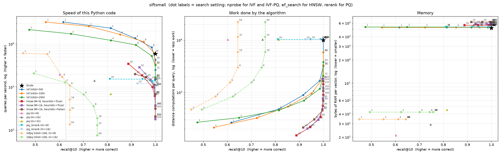
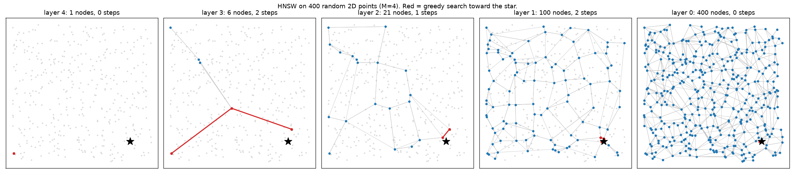

# vecsearch

A vector search engine built from scratch, to learn what FAISS and HNSW-based
databases do underneath. Every index is measured on the same benchmark:
recall@10, queries per second, distance computations per query, build time,
and memory.

## Status

| Phase | Index | Status |
|---|---|---|
| 0 | dataset loaders, ground truth | done |
| 1 | brute force + benchmark tool | done |
| 2 | k-means + IVF | done |
| 3 | HNSW | done |
| 4 | Product Quantization, IVF-PQ | done |
| 5 | persistence, delete, filter, API | done (RAG chatbot integration next) |
| 6 | comparison with FAISS / hnswlib | |

## Setup

```bash
python -m venv .venv
.venv/Scripts/python -m pip install -r requirements.txt   # Windows
# .venv/bin/python -m pip install -r requirements.txt     # Linux / macOS
```

## Commands

```bash
python -m pytest                          # run tests (synthetic data, no download)
python -m bench.run                       # benchmark on synthetic data
python -m vecsearch.datasets download     # download SIFT10K (~5 MB) into data/
python -m bench.run --dataset siftsmall   # benchmark on SIFT10K
python -m bench.plot --dataset siftsmall  # draw the charts
python -m bench.draw_graph                # draw a small 2D HNSW, layer by layer
python -m bench.filtered                  # filtered search experiment on SIFT10K
python -m vecsearch.api --path data/store.npz --dim 384   # start the web API
```

## Using it as a database

```python
from vecsearch import VectorStore

store = VectorStore(dim=384, index="hnsw")        # or index="flat" for exact
store.add(
    ["dsa_p12_c1", "dsa_p12_c2"],                 # your own string ids
    embeddings,                                   # (2, 384) array
    [{"chapter": 3, "page": 12}, {"chapter": 3, "page": 12}],
)
store.search(query_embedding, k=5, filter={"chapter": 3})
# [{"id": "dsa_p12_c1", "score": 0.83, "distance": 0.34, "metadata": {...}}, ...]

store.delete(["dsa_p12_c2"])
store.save("data/store.npz")
store = VectorStore.load("data/store.npz")
```

- **Cosine similarity:** vectors are normalized when added, so `score` is
  cosine similarity, the measure sentence-transformers embeddings use.
- **Upsert:** adding an existing id replaces it.
- **Delete** marks an item as a tombstone. It is never returned, but its
  vector stays in the graph, because other nodes may route through it.
  `compact()` rebuilds the index without tombstones.
- **Filters:** `{"chapter": 3}` means equals; `{"chapter": [3, 4]}` means
  one of.
- **Save** writes one `.npz` file with a format version. It writes to a
  temporary file and renames it over the old one, so a crash mid-save
  leaves the previous file intact (a test simulates this). The HNSW
  random-generator state is saved too, so adding items after a load builds
  exactly the same graph as adding them before the save.

The web API (`vecsearch/api.py`) exposes the same operations over HTTP:
`POST /items`, `GET /items/{id}`, `DELETE /items/{id}`, `POST /search`,
`POST /compact`, `POST /save`, `GET /stats`. Once the server is running,
`http://127.0.0.1:8000/docs` gives an interactive page for each endpoint.

Results are written to `bench/results/<dataset>.json` and the charts to
`bench/results/<dataset>.png`. A full SIFT10K run takes about 5 minutes,
mostly HNSW builds. Run one benchmark at a time: two at once compete for
the CPU and both report lower speeds.

## Results so far (SIFT10K, k=10, one query at a time, single machine)



Left: speed of this Python code. Middle: distance computations per query,
which measures the algorithm itself, independent of language. Right: bytes
of RAM per stored vector.

| index | setting | recall@10 | distances / query | bytes / vector | queries/sec |
|---|---|---|---|---|---|
| brute | | 1.000 | 10,000 | 516 | 5,900 |
| IVF nlist=50 | nprobe=8 | 0.985 | 1,682 | 527 | 8,377 |
| IVF nlist=100 | nprobe=16 | 0.995 | 1,785 | 529 | 6,171 |
| HNSW M=16 | ef_search=20 | 0.980 | 300 | 585 | 1,491 |
| HNSW M=16 | ef_search=40 | 0.996 | 480 | 585 | 973 |
| PQ m=8 | | 0.602 | 10,256 | **21** | 1,954 |
| PQ m=16 | | 0.747 | 10,256 | 29 | 1,406 |
| PQ m=32 | | 0.815 | 10,256 | 45 | 691 |
| PQ m=8 + re-rank | rerank=100 | 0.988 | 10,356 | 533 | 1,346 |
| IVF-PQ nlist=100, m=8 | nprobe=8 | 0.644 | 3,007 | 34 | 1,089 |
| IVF-PQ nlist=100, m=16 | nprobe=16 | 0.758 | 5,881 | 42 | 188 |

Recall, distance counts and memory are deterministic. Queries/sec are from
one run with all indexes measured back to back on a laptop that was also
running other apps; compare them within this table, not across runs.
For PQ, one "distance" is one ADC table-lookup sum, which is much cheaper
than a full 128-number distance.

## How HNSW searches



The search starts at the single node on the top layer, takes long jumps
on the sparse upper layers, and drops a layer each time no neighbour is
closer to the query. By layer 0 it is already next to the target.

## What I learned

**IVF needs data with structure.** On random Gaussian vectors IVF is
nearly useless (nlist=100, nprobe=8 finds 25% of the true top 10); on SIFT,
the same setting finds 95%. Random high-dimensional points are all about
equally far apart, so clusters mean nothing. Real embeddings cluster, which
is why IVF works. Benchmarks on random data alone would be misleading.

**How you compute distance mattered more than the algorithm.**
`((v - q) ** 2).sum(1)` builds a temporary array as big as all the vectors
being checked. Past about 256 KB the allocation got ~4x slower on this
Windows machine, which made IVF's speed fall off a cliff between nprobe=4
and nprobe=8. Rewriting it as `||v||^2 - 2 v.q + ||q||^2` with the norms
stored at add time (one matrix-vector product, no big temporary) made
brute force 18x faster and removed the cliff. Recall did not change.

**At 10,000 vectors, Python overhead limits IVF.** Each probed list costs a
Python loop step, so with nprobe=64 IVF is slower than brute force, and the
best speed-up at recall >= 0.95 is about 3x. The gap should grow with
dataset size; that is for the 1M-vector SIFT run.

**HNSW does the least work but runs slowest here, and both are true.** At
about 98% recall, HNSW computes 300 distances per query, IVF 1,682 and
brute force 10,000. But brute force and IVF do a few large NumPy operations
(fast C loops), while HNSW does hundreds of small Python steps per query
(heap pushes, set lookups). At 10,000 vectors, Python overhead dominates,
so queries/sec mostly measures Python. That is why the benchmark also
counts distance computations: it is the number that would carry over to a
C++ or Rust implementation, and it is what the HNSW paper reports.

**HNSW can lose nodes.** When a node's link list is full, the paper's
algorithm trims it, and that can delete the only link into some other node.
That node can then never be found. On 1,000 random vectors:

| neighbour rule | M=4 | M=8 | M=16 |
|---|---|---|---|
| heuristic (Algorithm 4) | 8 unreachable | 1 | 0 |
| simple (closest M) | 40 | 8 | 0 |

Small M makes it worse; the heuristic, which spreads links in different
directions, makes it better. The test suite checks that M=16 reaches every
node.

**The heuristic helps less than expected on SIFT10K.** With M=16 the
heuristic and simple rules reach nearly the same recall for the same work,
and the simple rule builds about 1.8x faster. The heuristic matters more
for clustered data, where the simple rule tends to link only inside a
cluster; that is worth testing on GloVe.

### Product Quantization: memory saved vs recall lost

**PQ m=8 stores SIFT10K in 24x less memory and loses 40% of recall@10.**
516 bytes per vector become 21. Of those 21, only 8 are the code; the
other 13 are the 128 KB of codebooks shared by 10,000 vectors. At 1M
vectors the codebooks cost 0.1 bytes each, so the saving approaches 64x.
More chunks buy recall back: m=16 gives 0.747 at 29 bytes, m=32 gives 0.815
at 45 bytes. Recall@10 is strict: PQ usually finds vectors that are very
close, but not exactly the true top 10 in the right order.

**Re-ranking recovers almost all of it, but needs the original vectors.**
Taking the top 100 by PQ distance and re-scoring them exactly lifts m=8
from 0.602 to 0.988. But the originals must be stored, so memory goes
back to 533 bytes. Real systems keep the codes in RAM and the originals on
SSD, and read only those 100 per query; this project keeps both in RAM and
counts both.

**IVF-PQ hits a recall ceiling.** With m=8, recall stops at 0.644 from
nprobe=8 onward: probing more lists no longer helps because the true
neighbours are already in the probed lists, and PQ's rough distances
rank them wrong. The limit is the code, not the search.

**Encoding residuals beats encoding raw vectors.** With the same 8-byte
code, IVF-PQ (which encodes vector minus cluster center) reaches 0.644
while flat PQ reaches 0.602. Residuals are smaller and centered on zero,
so 256 centers per chunk describe them more precisely. A test checks this.

**At 10,000 vectors IVF-PQ is badly sized.** Every probed list needs its
own distance table, which costs as much as 256 full distances, but each
list holds only about 100 vectors. At nprobe=64 that is 22,229 distance
equivalents per query, more than brute force. IVF-PQ is built for lists
of thousands of vectors (millions in total), and FAISS adds a
precomputed-table trick that removes most of the per-list table cost.

**The ids cost as much as the codes.** In IVF-PQ m=8, each vector costs
8 bytes of code and 8 bytes of int64 id (plus shared codebooks and
centers). Compressing vectors makes the bookkeeping visible.

**PQ in NumPy is slower than brute force.** Each ADC step is a gather
(`table[j][codes[j]]`), which NumPy does far more slowly than the single
BLAS matrix-vector product brute force uses. In C, ADC lookups are fast;
here flat PQ manages 1,954 queries/sec against brute force's 5,900 in the
same run. Its benefit in this project is memory, not speed.

**Random data breaks PQ too.** On the synthetic Gaussian vectors, PQ m=8
gets 0.100 recall and IVF-PQ m=8 never passes 0.099. Like IVF, PQ relies
on structure in the data.

### Filtered search

Three ways to answer "the top 10 among items matching a filter", on
SIFT10K with HNSW M=16, ef_search=40, and a random fraction of items
matching (`bench/filtered.py`):

| matching | post-filter: results returned | in-graph: results | in-graph: distances | exact scan: distances |
|---|---|---|---|---|
| 50% (4,990) | 4.8 of 10 | 10, recall 0.998 | 767 | 4,990 |
| 10% (1,001) | 1.1 of 10 | 10, recall 1.000 | 2,050 | 1,001 |
| 1% (99) | 0.09 of 10 | 10, recall 1.000 | 5,384 | 99 |
| 0.2% (16) | 0.03 of 10 | 10, recall 1.000 | 10,040 | 16 |

**Searching first and filtering after does not work.** It finds the top 10
overall and then throws most of them away; with a 1% filter it returns
almost nothing.

**Filtering inside the graph always returns k results, but gets expensive
as the filter gets rarer.** It must walk through non-matching nodes to
reach matching ones. At 0.2% it visits the whole graph.

**For rare filters, an exact scan of just the matching items is cheapest
and never misses.** So `VectorStore` switches to an exact scan when fewer
than `exact_below` items match (default 1,000). On SIFT10K the exact scan
still wins at 1,001 matches (1,001 vs 2,050 distances), so the best
switch-over point here is somewhere between 1,000 and 5,000 matches.
Production databases such as Qdrant use the same idea.

## Layout

```
vecsearch/datasets.py   .fvecs/.ivecs readers, synthetic data, exact ground truth
vecsearch/brute.py      exact search (the reference every other index is checked against)
vecsearch/kmeans.py     k-means clustering
vecsearch/ivf.py        IVF index: search only the nprobe nearest clusters
vecsearch/hnsw.py       HNSW graph index (Malkov & Yashunin, Algorithms 1-5)
vecsearch/pq.py         Product Quantization codec, flat PQ index (with optional
                        re-ranking), and IVF-PQ (PQ on residuals)
vecsearch/store.py      VectorStore: string ids, metadata, filters, delete,
                        compact, cosine scores, atomic save/load
vecsearch/api.py        FastAPI web server for a VectorStore
bench/run.py            the benchmark tool; each new index registers in INDEXES
bench/plot.py           recall vs QPS, distance count, and memory charts
bench/draw_graph.py     2D picture of HNSW layers and a search path
bench/filtered.py       post-filter vs in-graph filter vs exact scan
docs/                   images used by this README
tests/                  pytest
```

## Notes

- Distances are squared L2 (no `sqrt`: it does not change the ranking).
- Ground truth for synthetic data is computed in float64 with a full sort,
  separately from the brute-force index, so the index is tested against an
  independent reference.
